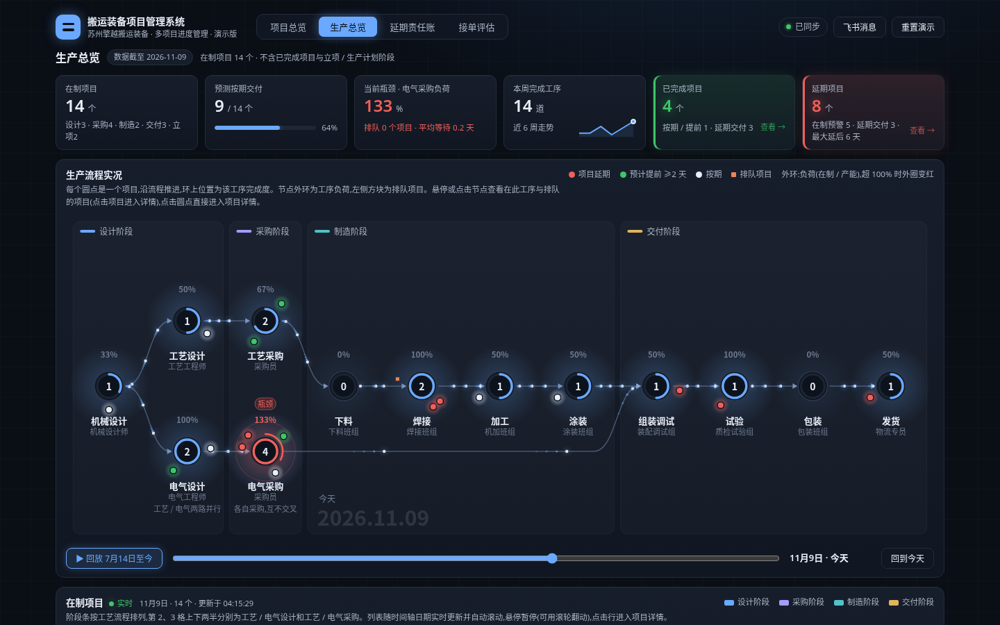
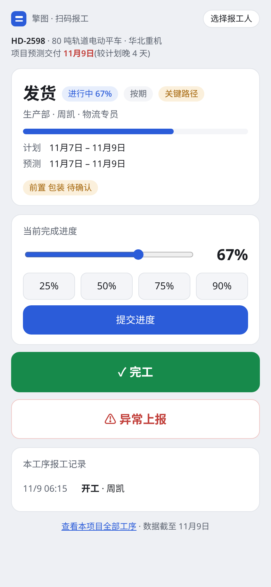
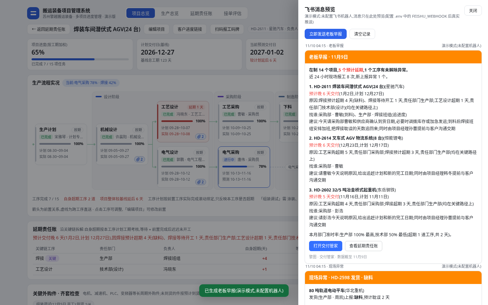
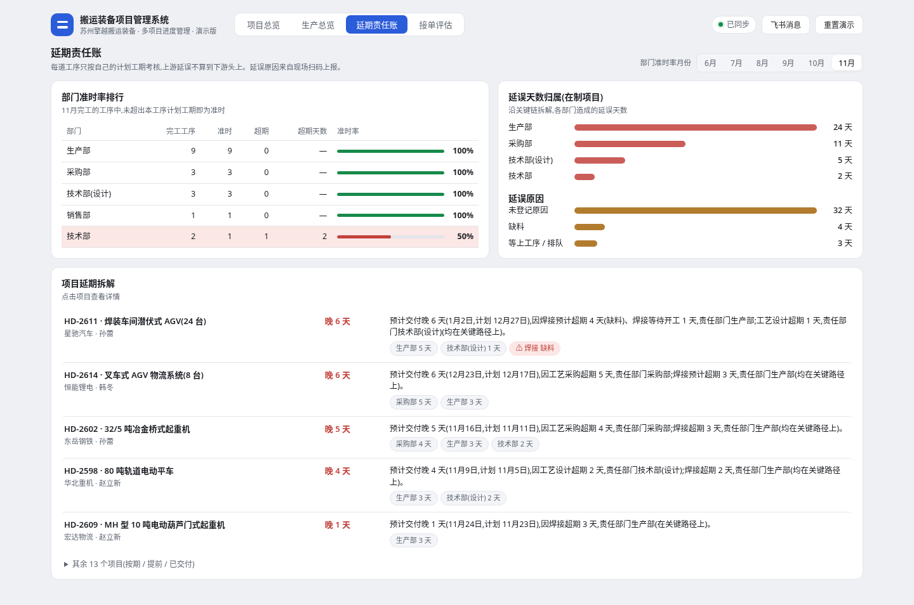
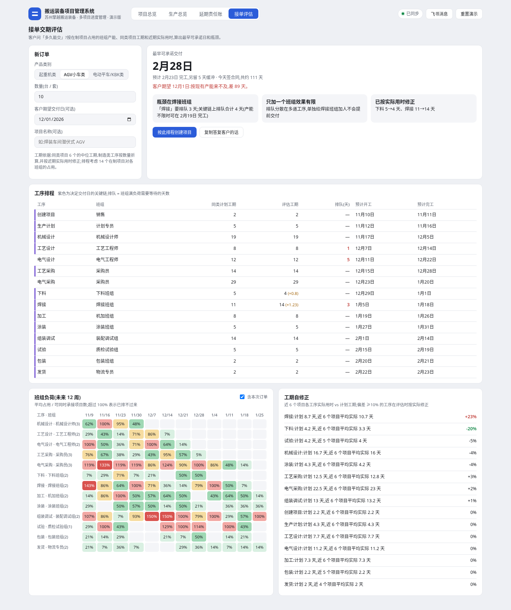
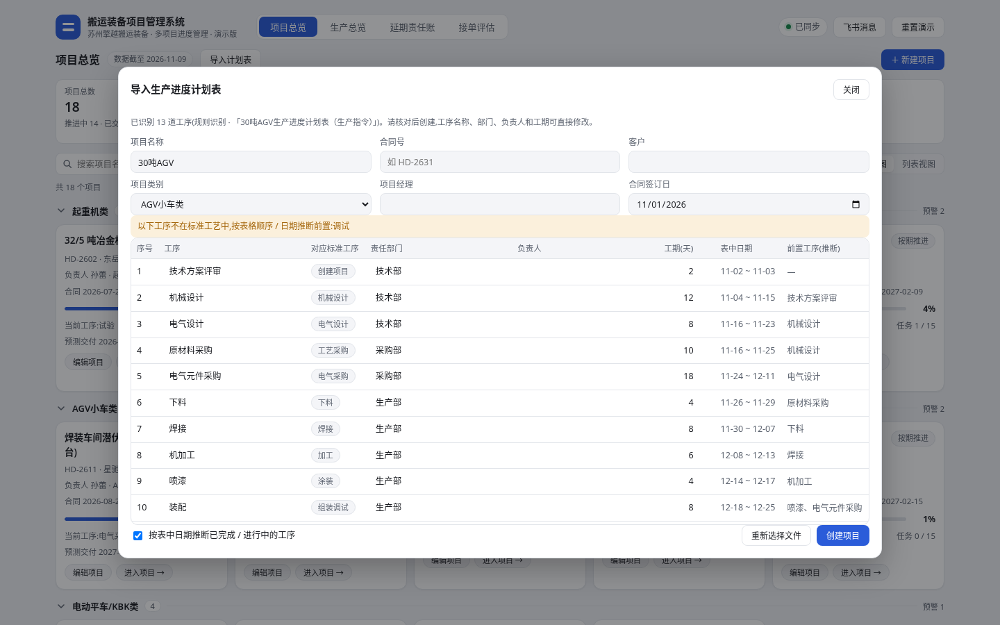
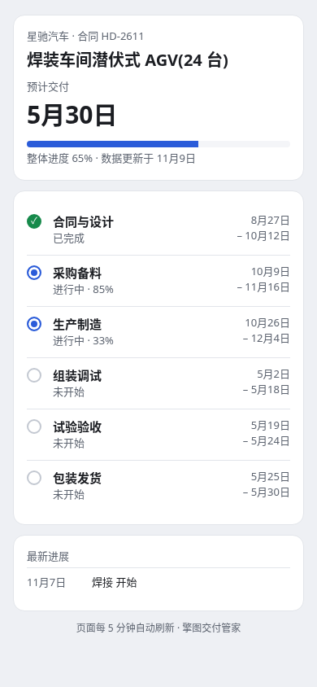

# 擎图 · 不用学软件的交付管家

> 工人扫码 10 秒报工,老板每天早上在飞书收到一条消息:哪几个订单要延期、为什么、该找谁。

面向非标搬运装备(起重机、AGV、电动平车、KBK)这类按单设计、按单生产的工厂。它回答老板最关心的三个问题:

1. **哪些订单会延期,晚几天?** 基线计划 + 按前置实际完成滚动排定 + 关键路径 + 外购件到货,实时预测交付日。
2. **是谁的责任?** 每道工序只按自己的计划工期考核,上游延误不传染下游;沿关键链把延期拆到部门和原因(延期责任账)。
3. **新订单敢承诺哪天交?** 按在制项目占用的班组产能做有限产能排程,结合已完工项目的实际用时,算出最早可承诺日和瓶颈班组。

演示脚本与常见问题见 [DEMO.md](DEMO.md)。



## 功能

| 模块 | 说明 |
|---|---|
| 扫码报工 | 每道工序一张二维码码牌(可打印)。手机扫码,不用装 App、不用登录:开工 / 进度 / 完工 / 异常上报(原因、预计耽误天数、照片)。下道工序开工即确认上道完工。 |
| 实时同步 | 报工、编辑后大屏、项目页、其他电脑实时刷新(SSE),数据保存在服务端,刷新、重启都不丢。 |
| 飞书老板早报 | 每天 08:00 推送到飞书群:最危险的 3 个项目、原因、找谁、今天该做什么;项目首次预测延期、现场上报异常时即时推送。可选由 Claude 撰写。 |
| 延期责任账 | 项目延期按关键链拆到工序、部门、原因;月度部门准时率排行;自动生成延期解释(「交付晚 6 天,因焊接缺料超期 4 天……」)。 |
| 导入 / 导出计划表 | 上传现有的 Excel / CSV「生产进度计划表」或粘贴飞书表格链接,自动识别工序、部门、日期、工期、前置关系;按同样格式导出 Excel 或写回飞书表格。 |
| 接单交期评估 | 选产品类别和数量,得到最早可承诺日、瓶颈班组、期望日能否满足、加班能追回几天;班组负荷热力图;工期按近期实际自修正。 |
| 关键外购件 | 电机、减速机、PLC、变频器等到货跟踪,未到货的件按预计到货日推迟所需工序,齐套检查。 |
| 客户进度链接 | 只读手机页发给客户,显示里程碑和预计交付,内容由老板控制,随时关闭或更换。 |

## 运行

需要 Node.js 18 及以上版本。

```bash
node server.js            # 或 npm start
# 电脑 / 大屏打开 http://localhost:8080
# 手机和电脑连同一 Wi-Fi,扫描系统里生成的工序二维码即可报工
```

- 服务端本身不依赖第三方包;只有用大模型撰写早报 / 识别表格时需要先运行 `npm install`(安装 `@anthropic-ai/sdk`)。
- 数据保存在 `data/store.json`(不提交到 git)。右上角「重置演示」恢复演示数据。
- 不启动服务端、直接双击 `index.html` 也能打开(单机演示模式):项目、甘特图、责任账、接单评估可用,报工 / 飞书 / 导入需要服务端。
- `?today=2026-11-09` 或 `.env` 的 `DEMO_TODAY` 可固定「数据截至日」,方便录制演示。

## 配置(`.env`,参考 `.env.example`)

都不填也能完整演示:飞书消息会显示在系统右上角「飞书消息」预览里,早报使用模板。

| 变量 | 用途 |
|---|---|
| `PUBLIC_URL` | 手机扫码访问的地址,默认自动取本机局域网 IP |
| `FEISHU_WEBHOOK` / `FEISHU_SECRET` | 飞书群自定义机器人(群设置 → 群机器人 → 添加自定义机器人);开启签名校验时填密钥 |
| `FEISHU_APP_ID` / `FEISHU_APP_SECRET` | 飞书开放平台自建应用,用于读取 / 写入飞书电子表格、多维表格(见下方「飞书配置」) |
| `FEISHU_OWNER_OPEN_ID` / `FEISHU_OWNER_EMAIL` | 任填一项:导出新建的表格后把此人加为可编辑协作者并尝试转移所有权 |
| `FEISHU_TZ` | 多维表格日期换算时区,默认 `Asia/Shanghai` |
| `FEISHU_DOMAIN` | 默认 `https://open.feishu.cn`,海外 Lark 用 `https://open.larksuite.com` |
| `BRIEF_TIME` | 老板早报推送时间,默认 `08:00`;留空则不定时推送 |
| `ANTHROPIC_API_KEY` / `ANTHROPIC_MODEL` | 可选,用 Claude 撰写早报、识别导入表格,默认模型 `claude-opus-5-5`;失败时自动回退模板 / 规则 |

## 飞书配置

### 1. 创建应用并开通权限

在[飞书开放平台](https://open.feishu.cn/app)创建「企业自建应用」,把 App ID / App Secret 填入 `.env` 的 `FEISHU_APP_ID` / `FEISHU_APP_SECRET`。在应用的「权限管理」中开通下列权限(括号内为 scope),然后**创建版本并发布**,权限才会生效:

| 用途 | 权限名称(scope) |
|---|---|
| 读写电子表格(导入、导出、新建工作表、扩展行列) | 查看、评论、编辑和管理电子表格(`sheets:spreadsheet`) |
| 新建电子表格 / 多维表格、写入失败时删除空表 | 查看、评论、编辑和管理云空间中所有文件(`drive:drive`) |
| 把你加为协作者、转移所有权 | 包含在 `drive:drive` 中;后台若提供细分权限,开通「添加云文档协作者」(`docs:permission.member:create`)和「转移云文档所有者」(`docs:permission.member:transfer`) |
| 读写多维表格(导入、新建数据表 / 字段、批量写记录) | 查看、评论、编辑和管理多维表格(`bitable:app`) |
| 解析知识库(/wiki/)链接 | 查看知识库(`wiki:wiki:readonly`) |

只读导入时,`sheets:spreadsheet:readonly`、`bitable:app:readonly` 也够用;导出需要上表中的读写权限。

### 2. 导出的表格归谁

应用用 `tenant_access_token` 新建的电子表格 / 多维表格**归应用所有**,默认你在飞书里打不开。两种解决方式(任选):

- 在 `.env` 填 `FEISHU_OWNER_OPEN_ID`(你在**该应用**下的 open_id,`ou_` 开头,可在开放平台「API 调试台」用「获取用户信息」查到)或 `FEISHU_OWNER_EMAIL`(飞书登录邮箱)。导出成功后系统把你加为**可编辑协作者**,并尝试**转移所有权**给你;转移失败时保留协作者权限。
- 导出时在「目标表格链接」中粘贴一个你自己的电子表格 / 多维表格 / 知识库链接,系统会在其中新建一个「项目编号 项目名 日期」的工作表 / 数据表,不再新建文件。

两项都没配置时,导出结果和界面会提示「表格归应用所有,请配置 FEISHU_OWNER_* 或使用已有表格链接」。

### 3. 读写已有文档:把应用加为协作者

导入飞书表格、或写入到已有表格时,应用必须能访问该文档:在文档右上角「…」→「更多」→「添加文档应用」(或「分享」中搜索应用名)把应用加为协作者——导入需要「可阅读」,写入需要「可编辑」。知识库中的文档也可以把应用加为知识空间成员。

### 4. 支持的链接

| 链接 | 导入 | 导出 |
|---|---|---|
| 电子表格 `https://xxx.feishu.cn/sheets/<token>?sheet=<id>` | 读取指定工作表(无 `sheet` 时取第一张) | 在其中新建工作表并写入 |
| 多维表格 `https://xxx.feishu.cn/base/<app_token>?table=<table_id>` | 分页读取全部记录(无 `table` 时取第一张数据表),文本 / 数字 / 单选 / 多选 / 日期 / 人员 / 富文本等转成纯文本后按 Excel 导入的规则识别 | 在其中新建数据表、建字段,`batch_create` 每批 500 条写入 |
| 知识库 `https://xxx.feishu.cn/wiki/<token>` | 按挂载的文档类型(电子表格 / 多维表格)处理 | 同左 |
| 不填链接 | — | 新建电子表格或多维表格(在「写入飞书」对话框中选择) |

写入失败时会清理刚新建的表格 / 工作表 / 数据表,避免在应用云空间里留下空表。

### 5. 宽表导入:一行一个项目

表格(Excel / CSV / 电子表格 / 多维表格都行)如果没有「制作流程 / 工序」列,但有「项目名称」和多组「xx开始时间 / xx计划完成时间 / xx实际完成时间」列(如多维表格「项目执行表」),会自动识别为**宽表**:每行生成一个项目,预览里列出全部项目,确认后一次性创建。识别全靠列名关键词,不依赖列顺序;原来「一行一道工序」的表格行为不变。

- **映射**:项目名称、合同编号、设备需求 / 销售工程师(写入项目备注)、合同交货期;环节依次为 设计 → 采购 → 生产 → 厂内调试 → 包装 → 发货 → 厂外调试(表里有对应列才生成;厂内 / 厂外调试只在该行有数据时生成)。设计 / 采购 / 包装 / 调试沿用标准工序 id,「生产」「厂外调试」为自定义工序。发货计划 = 计划交付时间,实际 = 实际发货时间。
- **负责人**:生产 / 包装 / 厂内调试(含 AGV 调试负责人)/ 厂外调试(含售后负责人)对应工序负责人;进度记录、问题描述等写入工序 / 项目备注(未填写的「年 月 日」模板行会去掉)。
- **日期与状态**:有实际完成日期 → 已完成(实际工期与计划工期之差会进入延期责任账);已到开始时间 → 进行中;计划完成已过仍未完成 → 标记「延期 N 天」。缺开始时间的过程型环节按上一环节结束的次日推算(推不出则留空),其余缺的日期一律留空,不编造;无法判断的情况(如计划完成早于开始、实际完成晚于今天、后续环节已完成而前面没有实际完成)会在项目的提示里列出。
- **重复项目策略**:合同编号相同(其次项目名称相同)视为同一项目,默认**更新**:保留项目 id、零件清单和现场上报记录,用表中的项目信息、工序和日期整体替换。预览里每个项目可单独改为「新建为新项目」或「跳过」。

## 测试

```bash
npm install     # 安装测试用的 puppeteer-core(使用本机 Chrome)
npm test        # API 测试 + 无头 Chrome 页面测试(JS 错误、多终端同步、报工、导入导出等)
```

## 目录

| 文件 | 说明 |
|---|---|
| `index.html` | 电脑 / 大屏前端:项目总览、项目详情、生产总览、延期责任账、接单评估 |
| `m.html` | 手机扫码报工页(`/r/<项目>/<工序>`) |
| `c.html` | 客户进度页(`/c/<链接码>`) |
| `engine.js` | 共享引擎:排程、预测、关键路径、报工、责任账、交期评估(浏览器与服务端共用) |
| `server.js` | Node 服务端:静态文件、REST API、SSE 实时推送 |
| `lib/` | 存储、报工、飞书、早报与预警、导入导出(含零依赖 xlsx 读写)、客户链接、演示种子 |
| `samples/` | 示例计划表(Excel / CSV) |
| `test/` | API 与页面测试 |

## 截图

| 手机报工 | 飞书早报 | 延期责任账 |
|---|---|---|
|  |  |  |

| 接单评估 | 导入计划表 | 客户进度 |
|---|---|---|
|  |  |  |
